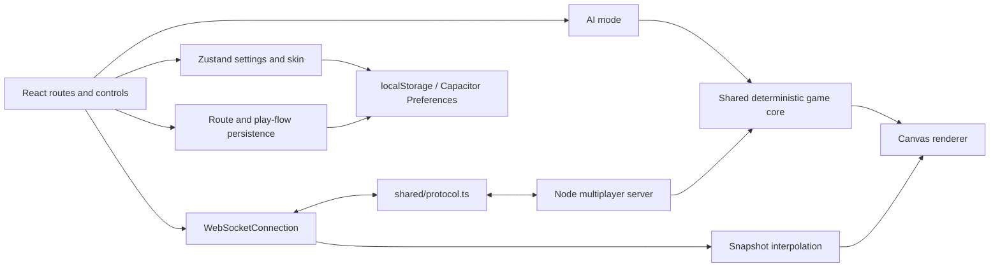

# Neon Serpent

Neon Serpent is a browser and mobile snake arena game. Play offline against AI
snakes or join an online room, collect food to grow, and customize your snake's
appearance and boost effects. The browser client also builds as a static
Capacitor app for Android and iOS.

## Features

- Offline AI matches with Easy, Normal, and Hard difficulties.
- Online multiplayer with quick play, regions, private rooms, and room codes.
- Snake customizer with illustrated skins, patterns, colors, eye styles, and
  boost effects.
- Auto-adaptive, High, Medium, and Low graphics profiles, plus Battery Saver
  and an FPS display.
- Touch joystick and boost control, mouse steering, and keyboard boost.
- Pause, restart, and resume countdown in AI mode only. Online matches remain
  live while the menu is open.
- Mobile and tablet layouts, Capacitor lifecycle integration, and native
  haptics, screen orientation, and preferences.
- Web builds and a separate client-only static app build.

## Technology

| Area                  | Technology                                                             |
| --------------------- | ---------------------------------------------------------------------- |
| UI and routing        | React `^19.2.0`, TanStack Start `1.168.60`, TanStack Router `1.170.41` |
| Build                 | Vite `^8.3.5`, TypeScript `^5.8.3`                                     |
| Styling               | Tailwind CSS `^4.2.1`                                                  |
| State and persistence | Zustand `^5.0.16`; browser localStorage and Capacitor Preferences      |
| Game rendering        | Canvas 2D                                                              |
| Multiplayer server    | Node.js, `ws` `^8.22.0`, esbuild `^0.28.2`                             |
| Tests                 | Vitest `^4.1.10`, jsdom `^20.0.3`, jest-dom matchers `^6.6.0`          |
| Quality tools         | ESLint `^9.32.0`, Prettier `^3.7.3`                                    |
| Mobile wrapper        | Capacitor `^8.5.3`                                                     |

## Project layout

```text
.
├── android/                 Capacitor Android project
├── assets/                  Capacitor icon and splash source images
├── docs/                    Flow, performance, release, store, and deployment guides
├── ios/                     Capacitor iOS project
├── public/
│   ├── fonts/                Self-hosted fonts and their licenses
│   └── skins/                Illustrated snake head/body PNG pairs
├── scripts/                  Version bump helper
├── server/src/               Node WebSocket multiplayer server
├── shared/protocol.ts        Client/server WebSocket message types
└── src/
    ├── app/                  Client entry and app lifecycle runtime
    ├── components/           Game HUD, controls, menu, and customizer previews
    ├── game/
    │   ├── core/              Deterministic simulation and AI
    │   ├── flow/              Play-mode state machine
    │   ├── net/               Mock and WebSocket connections, interpolation
    │   └── render/            Canvas rendering, skins, and quality profiles
    ├── lib/                   Persistence, platform, device, and server helpers
    ├── routes/                TanStack file-based routes
    ├── router.tsx             Router creation
    └── styles.css             Global styles and self-hosted font faces
├── capacitor.config.ts       Native app identity and plugin configuration
├── render.yaml               Render server Blueprint
├── vite.app.config.ts        Client-only static app build
└── vite.config.ts            Web/TanStack Start build
```

## Architecture

The simulation is pure TypeScript. AI mode advances it locally in the browser;
online mode runs the same core on the Node server. The renderer is separate
from the simulation and draws the local/interpolated state to Canvas 2D.



- `src/game/core/` owns game state, deterministic seeded randomness, bot
  behavior, movement, collision, eating, growth, and scoring data. The browser
  calls `update()` for AI mode. Each online server room calls the same `update()`
  at 60 simulation ticks per second.
- `src/game/render/` draws snakes, orbs, the arena, minimap, and HUD overlays.
  Customizer previews use the shared `drawSnake()` renderer.
- `src/game/net/` defines the UI-facing `GameConnection`, a local mock
  connection, WebSocket transport, and interpolation of 20 Hz server snapshots.
- `shared/protocol.ts` defines typed `join`, `input`, and `ping` client messages
  and `welcome`, `state`, `pong`, and `error` server messages.
- Zustand persists player settings and skin through `gameStorage`: localStorage
  in a browser and Capacitor Preferences on native platforms. Last route,
  scroll position, and play-flow state are stored separately in localStorage.

## Getting started

Use Node.js 24 and npm. CI uses Node 24; Render specifies Node 24.20.0.

```sh
npm ci
npm run dev
```

Open the Vite URL printed in the terminal. AI mode works without a multiplayer
server. For local online play, run the server in another terminal and configure
the client URL:

```sh
npm run server:dev
```

The server defaults to port `3000`. Create `.env.local` for Vite with:

```dotenv
VITE_WS_URL=ws://localhost:3000
VITE_HTTP_URL=http://localhost:3000
```

The server checks the browser's `Origin`. In PowerShell, allow the local Vite
origin when starting it:

```powershell
$env:ALLOWED_ORIGINS = "http://localhost:5173"
npm run server:dev
```

If Vite prints a different origin, use that exact origin. The server's
`ALLOW_NO_ORIGIN` default is false.

### Environment variables

| Variable                    | Used by               | Default / behavior                                                                                                                                                                     |
| --------------------------- | --------------------- | -------------------------------------------------------------------------------------------------------------------------------------------------------------------------------------- |
| `VITE_WS_URL`               | Client build          | In development the client can fall back to `ws://localhost:8080`; set it explicitly for the local server or production. Production multiplayer needs a configured secure `wss://` URL. |
| `VITE_HTTP_URL`             | Client build          | Derived from the WebSocket origin (`wss` → `https`, `ws` → `http`) when unset; used for health/info endpoints.                                                                         |
| `VITE_ERROR_REPORT_URL`     | Client build          | Optional error-report POST endpoint; unset means reports stay in console/on-device.                                                                                                    |
| `VITE_TARGET`               | Client build          | `vite.app.config.ts` defines it as `app` for the static app build. It is not otherwise required.                                                                                       |
| `PORT`                      | Server                | `3000`.                                                                                                                                                                                |
| `ALLOWED_ORIGINS`           | Server                | Empty list; browser and WebSocket origins are rejected until configured. Comma-separated exact origins.                                                                                |
| `ALLOW_NO_ORIGIN`           | Server                | `false`. Set to `true` only for native clients that truly omit `Origin`.                                                                                                               |
| `RENDER_REGION`             | Server                | `singapore`.                                                                                                                                                                           |
| `npm_package_version`       | Server                | `1.0.0` if npm does not provide the package version.                                                                                                                                   |
| `ANDROID_KEYSTORE_PATH`     | Android release build | Optional fallback when `android/keystore.properties` does not specify the signing file.                                                                                                |
| `ANDROID_KEYSTORE_PASSWORD` | Android release build | Optional environment fallback; otherwise read from local signing properties.                                                                                                           |
| `ANDROID_KEY_ALIAS`         | Android release build | Optional environment fallback; otherwise read from local signing properties.                                                                                                           |
| `ANDROID_KEY_PASSWORD`      | Android release build | Optional environment fallback; otherwise read from local signing properties.                                                                                                           |

Do not commit signing credentials. See [Android release](./docs/ANDROID_RELEASE.md)
for local properties and GitHub Secrets.

## npm scripts

| Script                          | Purpose                                                                 |
| ------------------------------- | ----------------------------------------------------------------------- |
| `npm run dev`                   | Start the web development server.                                       |
| `npm run build`                 | Build the TanStack Start web target configured in `vite.config.ts`.     |
| `npm run build:app`             | Build the client-only static app into `dist-app/`.                      |
| `npm run build:dev`             | Build using Vite's development mode.                                    |
| `npm run preview`               | Preview the regular web build.                                          |
| `npm run preview:app`           | Preview the static app build.                                           |
| `npm run cap:sync`              | Build the static app and sync Capacitor platforms.                      |
| `npm run cap:android`           | Open the Android project in Android Studio.                             |
| `npm run cap:ios`               | Open the iOS project in Xcode.                                          |
| `npm run cap:assets`            | Generate native app icons and splash assets from `assets/`.             |
| `npm run version:bump -- patch` | Bump the package version (also accepts `minor` or an explicit version). |
| `npm run server:dev`            | Run the multiplayer server with `tsx watch`.                            |
| `npm run server:build`          | Bundle the server into `dist-server/index.js`.                          |
| `npm run server:start`          | Start the built multiplayer server.                                     |
| `npm run lint`                  | Run ESLint.                                                             |
| `npm run format`                | Format repository files with Prettier.                                  |
| `npm test`                      | Run the Vitest suite once.                                              |
| `npm run test:watch`            | Run Vitest in watch mode.                                               |

## Controls and match flow

| Input                             | Action                                          |
| --------------------------------- | ----------------------------------------------- |
| Mouse movement                    | Steer toward the pointer.                       |
| Hold left mouse button or Space   | Boost; boosting consumes length and drops food. |
| Touch joystick                    | Steer.                                          |
| Hold the on-screen boost button   | Boost.                                          |
| Esc / Pause button / Android Back | Pause or resume an AI match.                    |

Food orbs grow the snake. Colliding with another snake or the arena boundary
ends a run. AI difficulty changes bot count and behavior: Easy starts with 15
bots, Normal with 20, and Hard with 25.

Pausing is available only in AI mode: the simulation stops while paused and
Resume uses a 3-2-1 countdown. Online play has a live-match menu instead; the
world continues running. On AI Game Over, **Play Again** returns to difficulty
selection and **Main Menu** returns home. Online Play Again returns to the
lobby. See [the flow guide](./docs/FLOW.md) for reload, background, and
reconnection behavior.

## Graphics and performance

The default **Auto** mode chooses a starting tier from available device signals
and a short canvas benchmark, then adapts to frame timing. Auto tiers range from
0 (lowest) through 3 (highest). **High**, **Medium**, and **Low** force a
profile. Profiles control backing resolution, particles, glow/shadows,
background effects, trails, snake detail, shake, food effects, minimap updates,
and name tags. **Battery Saver** targets 30 FPS; the game simulation remains at
60 Hz. The FPS display includes the current Auto tier and resolution scale.

See [performance testing and tier details](./docs/PERFORMANCE.md).

## Tests

Run all unit tests with:

```sh
npm test
```

The Vitest suite covers deterministic core simulation and collisions, rendering
helpers and skin loading, play-flow/pause/persistence behavior, quality tier
logic, server configuration/reconnection, WebSocket handling, and multiplayer
server/room behavior. Test files are colocated with source and under
`server/`; `vitest.config.ts` runs them in jsdom where needed.

## Deployment

### Web

`npm run build` builds the configured TanStack Start web target (Cloudflare
Nitro in `vite.config.ts`). For a fully static host or Capacitor, use
`npm run build:app`; serve `dist-app/` with an SPA fallback to `index.html` for
`/play` and `/customize`. Set `VITE_WS_URL` and, optionally, `VITE_HTTP_URL`
before the production build to enable online play.

### Multiplayer server

The server is a separate Node service. Render uses the repository Blueprint in
[`render.yaml`](./render.yaml), with `/health` as its health check. Set
`ALLOWED_ORIGINS` to the website and native app origins. Rooms are held in
memory, so run one instance without autoscaling. Follow
[the Render deployment guide](./docs/DEPLOY_RENDER.md).

### Android and iOS

Capacitor uses `dist-app/` as `webDir`. Change the placeholder app ID in
`capacitor.config.ts` before publishing. Build/sync with `npm run cap:sync`,
then use Android Studio or Xcode. Android signing and iOS archive/TestFlight
steps, including platform requirements, are in
[Android release](./docs/ANDROID_RELEASE.md) and [iOS release](./docs/IOS_RELEASE.md).

## Customization

- Add an illustrated skin by adding original or properly licensed
  `<id>-head.png` and `<id>-body.png` files to `public/skins/`, then register it
  in `src/game/render/spriteSkins.ts`. The customizer discovers registered
  sprites through the skin presets.
- Add or change a ready-made procedural preset in
  `src/game/render/skinPresets.ts`. Patterns, eye shapes, and boost effects are
  defined by the shared renderer in `src/game/render/drawSnake.ts`.
- AI difficulty names and bot profiles are defined in
  `src/game/core/types.ts` and `src/game/core/config.ts`.
- Keep game rules in the pure `src/game/core/` module and use the shared
  renderer for the arena and customizer previews.

## Notes and known limitations

- Online rooms and player state are in memory. Server restart clears rooms; the
  deployment is intended for one server instance.
- Online snapshots identify opponents by procedural skin index; a player's
  selected illustrated skin is not currently transmitted for other clients to
  render.
- Multiplayer requires a reachable configured server. Render's free service
  can sleep and take time to wake.
- There are no player accounts, chat, or in-game economy/store at present.
- Tune game balance and performance on representative physical devices before
  release; browser emulation cannot reproduce every device's thermal, memory,
  or GPU limits.

## Contributing and rules

Read [AGENTS.md](./AGENTS.md) before changing code. Keep the simulation pure,
avoid duplicating snake rendering, preserve deterministic tests, and update
related documentation when behavior changes.

## License

TODO: choose and add a project license before distributing the source.
