# App flow and mobile behavior

## Route and game state diagram

```mermaid
stateDiagram-v2
  [*] --> Home: fresh install
  Home --> AISelect: Play vs AI
  Home --> OnlineLobby: Play Online
  Home --> CustomizeSnakes: Customize Snake
  CustomizeSnakes <--> CustomizeStyle: tab
  CustomizeSnakes --> Home: Menu / Android Back
  CustomizeStyle --> Home: Menu / Android Back

  AISelect --> AILoading: choose difficulty, Start
  AILoading --> AIPlaying: arena ready
  AIPlaying --> AIPaused: Pause / Esc / Android Back / background / rotate
  AIPaused --> AIPlaying: Resume, 3-2-1 countdown
  AIPaused --> AISelect: Restart
  AIPlaying --> AIGameOver: death
  AIGameOver --> AISelect: Play Again
  AIPlaying --> AIInterrupted: reload / process restart
  AIPaused --> AIInterrupted: reload / process restart
  AIInterrupted --> AISelect: Play Again
  AIGameOver --> Home: Main Menu
  AIInterrupted --> Home: Main Menu
  AISelect --> Home: Android Back / Main Menu

  OnlineLobby --> Connecting: Quick Play / join room
  Connecting --> OnlinePlaying: connected, arena ready
  Connecting --> OnlineLobby: retry / failed or restored session
  OnlinePlaying --> OnlineMenu: Menu / Android Back
  OnlineMenu --> OnlinePlaying: Close menu; match stays live
  OnlinePlaying --> OnlineGameOver: death
  OnlineGameOver --> OnlineLobby: Play Again
  OnlineGameOver --> Home: Main Menu
  OnlinePlaying --> Disconnected: connection lost
  Disconnected --> Connecting: Reconnect
  Disconnected --> AISelect: Play offline vs AI
  OnlinePlaying --> Connecting: background / foreground reconnect
  OnlineLobby --> Home: Android Back / Main Menu
```

## Screens and lifecycle behavior

| Screen | Entry and exit | Persisted data | Reload / app restart | Minimize and return | Android Back |
|---|---|---|---|---|---|
| Home | Fresh launch, Main Menu, or Back from a top-level screen; play/customize links leave it. | Nickname and settings in the Zustand store; last route has a timestamp. | A fresh install stays here. Launching at `/` restores a valid last route up to 24 hours old. | No special behavior; route and store remain saved. | First press displays “Press back again to exit”; second press within 2 seconds exits. |
| Customize — Snakes tab | Home → Customize Snake; tab control switches to Style; Menu returns home. | Skin, nickname, favorites and preset in the Zustand store; tab in `?tab=snakes`; last route and scroll position in localStorage. | Reopens the same tab, skin and saved scroll position. A direct `/customize` refresh is respected. | Tab, skin and scroll position remain; no game simulation is running. | Returns home. |
| Customize — Style tab | Select Style from Customize; Snakes switches back. | Same as Snakes; URL stores `?tab=style`; skin edits are immediately stored. | Reopens Style with the selected skin/effects and saved scroll position. | Same as Snakes. | Returns home. |
| Settings | Open Settings from the AI pause menu or online match menu; close/back returns to that menu. | Settings (sound, graphics, vibration, nickname, server, etc.) are in the Zustand store. Some transient control choices remain route-local. | Settings overlay is not reopened automatically; settings values remain. | In AI, the game pauses; online gameplay continues behind the panel. | In AI, closes through the pause flow (Back resumes with countdown); in online, closes/toggles the live-match menu. |
| AI difficulty select | Home → Play vs AI; Restart or Play Again returns here. Start begins loading. | Selected difficulty and AI flow in localStorage. | Reopens difficulty select with the previous difficulty selected. | No active simulation; selection stays available. | Returns home and clears game-flow data. |
| AI playing | Difficulty select → Start → loading. Pause, death, menu actions leave it. | AI flow and last known score; active simulation itself is not serialized. | Shows Interrupted Game with the last known score; it never starts a new run automatically. | Automatically pauses, clears held input and mutes audio. The overlay appears on return; Resume requires a tap and 3-2-1 countdown. | Opens the pause menu. |
| AI paused | Pause button, Esc, Android Back, backgrounding, or orientation change during AI play. Resume, Restart, Main Menu or death leaves it. | Phase, difficulty and last score are persisted; the running simulation is not. | Shows Interrupted Game because the simulation cannot be restored. | Remains paused; no automatic resume. | Resumes through the countdown. |
| AI Game Over | AI simulation ends on death. Play Again and Main Menu are the only primary choices. | Death statistics and selected difficulty are persisted. | Reopens the same Game Over screen and statistics. | Game Over remains visible on return. | Returns home and clears the finished run. |
| AI Interrupted Game | Reload or process restart while AI was loading, playing or paused (loading restores to select). | Last known score and difficulty. | Shows “Interrupted game”; Play Again returns to difficulty selection; Main Menu clears the run. | Not applicable; this screen is already the recovered state. | Returns home and clears the run. |
| Online lobby | Home → Play Online, online Play Again, or online restore. Quick Play / room join begins connecting. | Previous room code, nickname, skin and settings. | Reopens the lobby with the last room code; online never enters AI difficulty selection. | Lobby stays available; no active match. | Returns home. |
| Connecting | Lobby → Quick Play / join; Reconnect after a drop. Success enters the arena; errors offer Retry/offline play. | Mode and room code are retained. | A pending connection is not resumed; returns to the lobby with the room code. | An in-flight connection is subject to platform networking; returning to lobby/retry is available. | Returns home. |
| Online playing | Successful connection and arena load. Menu, death, connection loss or leaving changes the screen. | Online mode, room code and last flow state; the server owns the live simulation. | A non-dead online state restores to the lobby (room prefilled); it does not pretend a socket survived reload. | Never pauses the world. The client closes its socket in background and reconnects on foreground/network return; while away the snake is vulnerable. A warning appears on return. | Opens/toggles the live match menu; the game keeps running. |
| Online Game Over | Server reports the player dead. Play Again and Main Menu are the primary choices. | Death stats and room code. | Reopens the same online Game Over screen. | Game Over remains visible. | Returns home and clears the run. |
| Disconnected | Online socket drops while the game is live. Reconnect returns to connecting; offline play switches to AI. | Room code and online flow remain available. | Reopens the lobby with room code prefilled. | Network/app-state listeners attempt reconnect; a visible reconnecting state or explicit disconnected overlay is shown. | On the live screen, opens the online menu; otherwise returns home. |

### Navigation and persistence notes

- The root waits for Zustand hydration before rendering a route that reads nickname, skin or graphics settings.
- The last screen record contains route, relevant search parameters, scroll position and a timestamp. It is ignored and removed if malformed or older than 24 hours.
- Game flow is saved separately for AI and online in localStorage. Corrupt flow data is removed and each mode falls back to its safe initial screen.
- A deliberate deep-link / hard refresh on `/play` or `/customize` is honored. Last-screen redirection runs only when startup begins at `/`, preventing saved state from overriding a browser URL.
- Exiting `/play` cancels wake-up requests and timers, disconnects sockets, resets controls, stops audio and removes listeners. The game loop is cleaned up when its route/effect unmounts.
- AI pause is guarded by mode in both the pause reducer and route event handling. Online menu is not a pause: it displays “Game is live” and leaves the simulation running.

## Audit scenario coverage

| Scenario | Automated coverage | Manual device/browser check |
|---|---|---|
| Customize minimize/reopen preserves tab and skin | `appPersistence.test.ts` validates route/tab storage; skin persistence is provided by Zustand. | Change skin, select Style, background/kill and reopen; confirm selection and scroll. |
| AI background pause and countdown resume | `pauseState.test.ts` covers background pause and resume countdown; route uses lifecycle events. | Play, background, reopen, tap Resume and confirm the countdown before movement. |
| Online background and reconnect | `WebSocketConnection.test.ts` covers reconnect/backoff and app/network lifecycle logic. | Background during a real match; confirm the match remains live and the client reconnects or offers rejoin without crashing. |
| Reload at home/customize/AI/online states | `appPersistence.test.ts` and `playFlow.test.ts` cover storage validation and phase restoration. | Hard-refresh each state on a static-host fallback server, especially AI/online Game Over. |
| Game Over Play Again/Main Menu cleanup | `playFlow.test.ts` covers mode-specific Play Again; route clears timers, connections and flow on exit. | Verify AI Play Again returns to difficulty (preselected), online Play Again to lobby, and Main Menu clears the run. |
| Pause only in AI | `pauseState.test.ts` and `playFlow.test.ts` reject online pause. | Confirm no Pause label, Esc pause, or pause overlay during an online match; Back opens the live menu. |
| Rotation on each screen; no stuck controls | Pure reset behavior is exercised through route handling, not a full device orientation simulation. | Rotate during each screen; verify joystick/boost reset and no layout break. |
| Rapid repeated taps | Reducer guards invalid transitions; there is no end-to-end tap-race test. | Repeatedly tap Pause/Resume/Play Again/Main Menu and ensure only one loop or connection starts. |
| Ten Home → Play → Back cycles; no leaks | Cleanup is implemented in effect teardown; no automated memory/leak test. | Repeat 10 times and inspect memory, audio and active sockets/listeners. |
| Fresh, corrupt and old storage | `appPersistence.test.ts` covers valid, stale and corrupt route data; store migration is tested by store tests. | Clear storage, corrupt saved JSON and test an older saved version. |
| Offline AI; online unavailable | AI uses the local mock simulation; server wait is abortable and error UI offers offline play. | Disable network; play AI end-to-end, then confirm online error and offline fallback. |
| Adaptive quality under load | `qualityProfile.test.ts` covers tier mapping and auto step changes. | Apply 4×–6× CPU throttling; confirm quality reduces while menus and flow remain responsive. |

## Responsive audit matrix

Checked the home and customize screens at 360×640, 390×844, 430×932, 768×1024 and 1024×768. No horizontal overflow was observed. Customize tab controls and its Menu control are at least 44 px high. The game overlays use safe-area padding and vertical scrolling. Real notch/home-indicator insets, orientation changes, low-end frame pacing and native back behavior still require physical-device QA.
